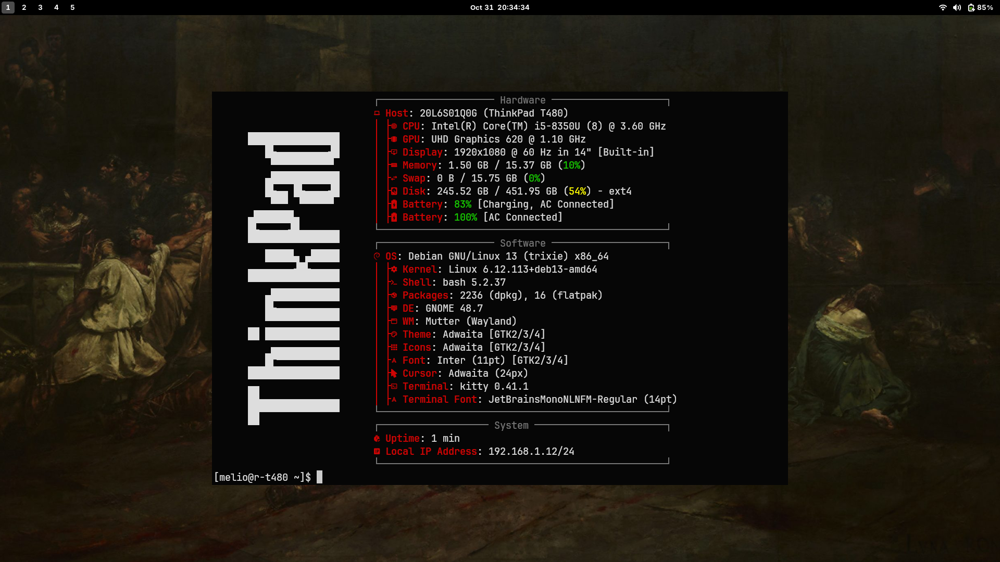

# My Setup

This repository contains my personal configuration files used for my programming environment. I like keeping things minimal but functional, so everything here is tuned for comfort, efficiency, and just enough personality to keep me sane.

## ThinkPad

I really love ThinkPad! I appreciate its simplicity, repairability, and durability. I am also a big fan of its keyboard too. I’m currently using a ThinkPad T480. Yes! a laptop from 2018, and it’s still going strong. One thing I love about this machine is the PowerBridge dual-battery system, which combines an internal battery with a removable external one. That means I can comfortably push long hours of usage without worrying too much.

## Debian

Debian remains my Linux distro of choice. It’s one of the oldest and most respected Linux distributions for a reason: stability, simplicity, and the amount of control it gives you over your system. On my T480, Debian runs exceptionally well. Performance is smooth, battery life(I use TLP) is solid, and there aren’t many unnecessary distractions getting in the way. It gives me a clean and focused environment where I can actually get things done without constantly fighting my operating system. Also, I will probably never get tired of Debian’s Toy Story naming scheme for their versioning especially as someone who really love that franchise.

For my desktop environment, I just use GNOME. I really like its workflow, especially on a laptop with a touchpad. I’ve tried quite a few alternatives over the years, including KDE Plasma, Sway/i3, Hyprland, and XFCE, but GNOME is still the one that suits me best. Its workspace-oriented workflow feels natural to me, and the touchpad gestures make switching between applications and workspaces feel really smooth. I also keep my setup pretty minimal, with only three extensions installed: Blur My Shell, Just Perfection, and Space Bar. It may not be everyone’s preferred desktop environment, but for the way I use my laptop, I genuinely love it!

## Kitty

Kitty is my terminal emulator of choice. What I like about it is how simple and straightforward the configuration is. My setup is intentionally minimal: no title bar, a completely black background, and no transparency. I basically want my terminal to feel like one giant fullscreen terminal whenever I’m using it. Another thing I really enjoy is its tab and pane workflow. Creating new tabs, splitting the terminal into panes, and keeping everything organized feels intuitive without requiring a complicated setup. Combined with its simple configuration file and keyboard shortcuts, it gives me pretty much everything I want from a terminal emulator without getting in my way.
